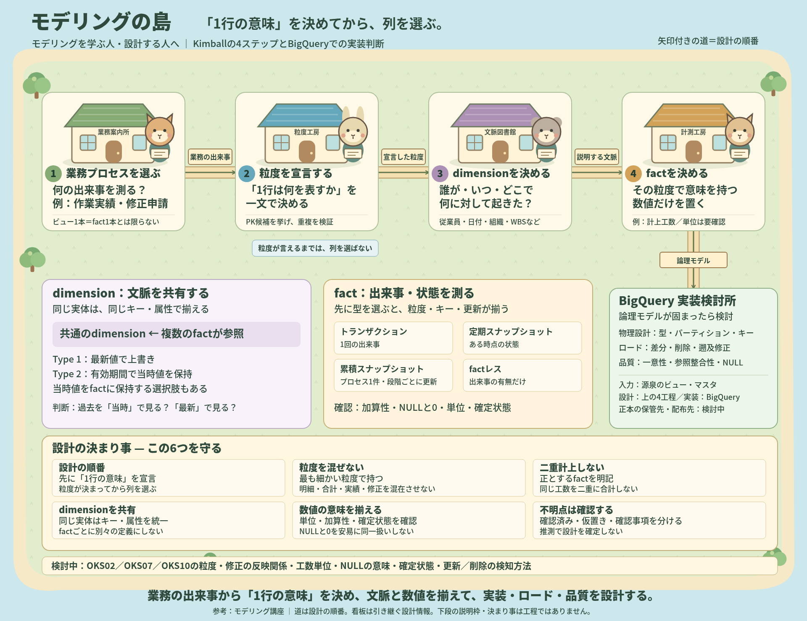

# モデリング講座

## モデリングの全体像

### 編集用HTML・SVG

文字・配置を修正する場合は、以下のHTMLを開いて編集し、保存してください。工程の建物を動かすと、道・矢印・看板も追従します。PNGは自動更新されません。

- [modeling-island.html](modeling-island/modeling-island.html)：編集用HTML
- [PNG・HTML・SVG・編集手順の一式](modeling-island/)

## 1. モデリングの原則

設計はKimballの4ステップの順で進める。

1. **業務プロセスを選ぶ**：テーブル単位ではなく「何の出来事を測るか」で考える。ビュー1本＝fact1本とは限らない。
2. **粒度を宣言する**：「1行は◯◯を表す」と一文で言えるまでは、列の選定に進まない。言えない場合は、源泉に確認すべき事項として残す。
3. **dimensionを決める**：その1行を説明する文脈（誰が・いつ・どこで・何に対して）を挙げる。
4. **fact（メジャー）を決める**：宣言した粒度で意味を持つ数値だけを置く。

そのうえで、次の原則を守る。

- **最も細かい粒度で持つ**：集計済みの形で持つと、あとから切り口を増やせない。
- **1つのfactに粒度を混ぜない**：明細と月次合計、実績と修正申請を同じ表に入れない。
- **同じ事実を2か所で数えない**：複数のfactが同じ工数を表す場合、どれが「正」で、どれを合計してはいけないかを明記する。
- **dimensionは共有する（comformed dimension）**：factごとに別のWBSdimensionを作らない。同じキー・同じ属性で揃える。
  - 参考文献：<https://zenn.dev/pei0804/articles/conformed-dimensions>
- **決められないことは決めない**：推測で埋めず、仮置きの前提と、源泉への確認事項に分ける。

## 2. fact設計の観点

factは「どの型か」を先に決めると、粒度・キー・更新方式が連動して決まる。

| 型 | 1行が表すもの | 行の更新 | 典型例 |
| --- | --- | --- | --- |
| トランザクション | 1回の出来事 | 原則しない（訂正は別行か上書き） | 売上明細、作業実績 |
| 定期スナップショット | ある時点の状態 | しない（時点ごとに追加） | 月末残高、月次締め時点の値 |
| 累積スナップショット | 開始から終了まであるプロセス1件 | 段階が進むたびに更新 | 受注→出荷→請求、申請→承認 |
| factレス | 出来事の有無だけ | 型による | 出欠、割当 |

factごとに、次の観点を検討する。

- **粒度とPK**：どの列の組み合わせで一意になるか。仕様書に無い場合、データで重複を確認する方法も考える。
- **メジャーの加算性**：全dimensionで合計できるか（加算的）、一部だけか（半加算的）、合計できないか（非加算的）。比率や「修正前の値」などは特に注意する。
- **派生メジャー**：差分やリードタイムなど、利用者が毎回計算するものはSilverで持つか。持つならその定義を書く。
- **NULLと0の区別**：NULLが「未入力」「削除」「対象外」のどれを意味するか。0に変換してよいか。
- **退化dimension**：伝票番号や履歴IDのように、dimension表を作らずfactに置くキー。
- **状態・フラグ列**：factの属性として持つか、集計対象を絞る条件として扱うか。どの状態の行を「確定値」とみなすか。
- **混ぜてはいけない量**：単位や意味が違う量が同じ列に入っていないか。入っているなら、分けるか、区別する列を必須にする。

## 3. dimension設計の観点

dimension設計の主な論点は、属性が時間とともにどう変わるかと、過去の事実をどの時点の属性で見せたいかを考える。

参考文献：<https://zenn.dev/yuichi_dev/articles/126f9a69cfb222>

| パターン | 内容 | 判断のポイント |
| --- | --- | --- |
| SCD Type 1 | 上書き。常に最新値 | 過去を最新の名前・分類で見てよいか |
| SCD Type 2 | 変更のたびに新しい行。有効期間を持つ | 過去を当時の値で見る必要があるか。結合が複雑になる |
| 当時値をfactに保持 | 計上時点の値をfactの列として持つ | 変化が多く、業務上「計上時点」が意味を持つ属性か |
| ロールプレイング | 1つのdimensionを複数の役割で参照する | 同じ実体が別の意味で何度も出てこないか |
| 退化dimension | dimension表を作らずfactに置く | 属性を持たないキーか |
| ジャンクdimension | 低カーディナリティのフラグを1表にまとめる | BigQueryでまとめる利点があるか |
| 未設定メンバー | 「未設定」「不明」を表す行 | 空文字・ダミー値・NULLをどこへ寄せるか |

dimensionごとに、次の観点を検討する。

- **元データの所在**：マスタから作るか、factの列からDISTINCTで作るか。後者の場合、同じコードに複数の名称が出たときの採用ルールを決める。
- **キー設計**：業務キーで結合するか、サロゲートキーを振るか。SCD2にするならどう振るか。
- **階層**：集計に使う階層（組織、WBSなど）を、どの列から作れるか。連結文字列を分割するのは最終手段とする。
- **同じ実体の表記ゆれ**：同じ人・同じ組織を指すキーが、ビューや列によって型や桁数が違わないか。
- **コード値の意味**：名称を持たないコード（区分・フラグ）を、どこで意味のある値に変換するか。

## 4. 具体的に考えるポイント

| No | テーマ | 問い |
| --- | --- | --- |
| Q1 | 粒度 | 3ビューはそれぞれ何の出来事・状態を表すか。ビュー1本をfact1本にしてよいか |
| Q2 | 粒度 | OKS02の1行は何を表すか。PK候補は何で、データでどう検証するか |
| Q3 | 粒度 | OKS07の修正はOKS02に反映されるか。両方を合計すると何が起きるか |
| Q4 | 粒度 | OKS10は単独のfactにするか、他のfactを作る材料にするか |
| Q5 | fact型 | OKS07は4つの型のどれに当たるか |
| Q6 | 列の差 | OKS02に無い列がOKS07・OKS10にある理由として、何が考えられるか |
| Q7 | メジャー | 計上工数の単位は何か。マシン区分によって量の意味が変わるのか |
| Q8 | メジャー | OKS07だけ計上工数がNULL許容なのはなぜか。NULLをどう扱うか |
| Q9 | メジャー | 修正による増減をどう定義し、どこで持つか |
| Q10 | メジャー | どの状態の行を「確定した工数」として集計するか |
| Q11 | dimension | 所属は従業員の属性か、factの属性か。異動した人の過去工数はどの組織で集計されるべきか |
| Q12 | dimension | 賃金計上先原価センタと原価センタは同じdimensionか |
| Q13 | dimension | OKS07の6人の担当者と6つの日時を、どうモデル化するか |
| Q14 | dimension | 名称が明細に埋め込まれている。同じコードで名称が変わっていたらどうするか |
| Q15 | dimension | 組織の階層（事業所〜班）で集計したい場合、何を元に階層を作るか |
| Q16 | dimension | ユーザを表す列は、すべて同じ従業員dimensionに結合できるか |
| Q17 | dimension | 名称を持たないコードはどう扱うか |
| Q18 | dimension | 計上先（WBS・OPA・原価センタ）が無い行には何が入っているか |
| Q19 | 属性 | テキスト項目01〜10と拠点別分析キーは何で、どう持つか |
| Q20 | 型・値 | SQL Serverの照合順序とBigQueryの文字列比較の違いは、結合キーに何を起こすか |
| Q21 | 型・値 | 日付・日時・数値をどの型に変換するか。タイムゾーンをどう扱うか |
| Q22 | 更新 | 更新日時で差分を取ると、何を取りこぼすか |
| Q23 | 更新 | 締切後の修正で過去日付の工数が変わる。どの範囲をどう再取込するか |

## 5. 物理設計・ロード・セキュリティの観点

論理モデルが固まったら、BigQueryで動かす前提の判断を加える。

### 物理設計

- パーティション列とクラスタリング列。利用者がよく絞り込む条件から逆算する。
- サロゲートキーを振るか。BigQueryでは連番の採番にコストがかかる。ハッシュキーや業務キーとの比較を示す。
- PK・FKを `NOT ENFORCED` で宣言するか。整合性はどこで担保するか。
- 型の対応（SQL Server → BigQuery）。精度と誤差が出ないかを確認する。

### ロード

- Bronzeの持ち方（全件洗い替えか追記か）と、Silverでの最新化の方法。
- 差分取得のキー、削除の検知、遡及修正の再取込範囲。
- 再実行しても結果が変わらない（冪等な）処理になっているか。

### データ品質

- PKの一意性、FKの参照整合性、必須列のNULL、値の範囲（工数の上限など）を、どのテストで確認するか。
- テストに失敗したとき、ロードを止めるか、警告だけにするか。
